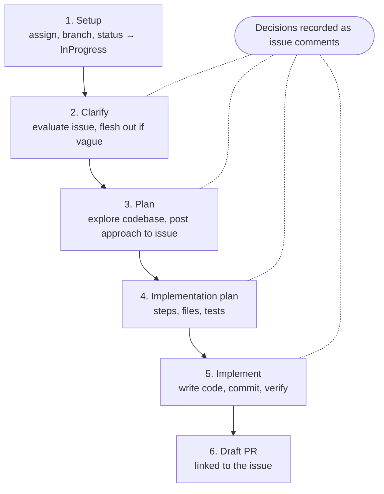

<div align="center">

# ghpm

**Agent skills for GitHub Projects v2, from triage to merged PR.**

Let your coding agent read the project board, pick the next issue,<br>
and drive it through plan, implementation, and a draft PR.

[](https://github.com/jackchuka/ghpm/releases)
[](LICENSE)

[Installation](#installation) · [Quick Start](#quick-start) · [Skills](#skills) · [ghpm-work](#ghpm-work-full-lifecycle) · [Configuration](#configuration)

</div>

---

GitHub Projects v2 holds the plan, but your agent can't see it. You end up pasting issue links into the chat, moving cards by hand, and losing the reasoning behind decisions in a terminal scrollback.

**ghpm** is a set of skills that teaches an AI coding agent (Claude Code or any agent that loads skills) to work with your project board through the `gh` CLI. It discovers the project's fields and views once, caches the items locally, and then answers "what's the state of the project?" and "what should I work on next?". It also runs a full work session on an issue, posting plans and design decisions back to the issue as comments.

## Features

- **Zero-config discovery**: `ghpm-init` reads fields, views, and repos from the project and writes `.ghpm/config.json`
- **Project dashboard**: status distribution, component health, epic tracking, per-person workload, and items that need attention
- **Views and filters**: query any saved project view by name, or filter in natural language (`in progress @alice`)
- **Context-aware suggestions**: recommends the next issue based on your current repo, recent commits, assignments, and constraints like "I have 2 hours"
- **End-to-end work sessions**: assign, branch, set status, plan, implement, and open a draft PR, resumable after a restart
- **Decisions on the record**: design choices are posted to the issue as comments, so the issue stays the single source of truth
- **Configurable confirmations**: choose per skill and per action whether to `prompt`, run `auto`, or `skip`
- **Local and private**: config, cache, and sessions live in a gitignored `.ghpm/` directory

## Installation

Install with the [`skills`](https://github.com/vercel-labs/skills) CLI:

```bash
npx skills add jackchuka/ghpm
```

### Prerequisites

- [`gh` CLI](https://cli.github.com/) installed and authenticated
- Token scopes `read:project` and `project`:

  ```bash
  gh auth refresh -s read:project,project
  ```

- A GitHub Projects v2 project (classic projects are not supported)

## Quick Start

1. **Initialize** from your repository root, pointing at the project:

   ```
   /ghpm-init https://github.com/orgs/<org>/projects/<number>
   ```

   ```
   ghpm initialized for Roadmap (acme/projects/7)

     Fields:    5 (Status, Component, Size, Quarter, Assigned Team)
     Views:     4 (Board, Task Triage, Daily Standup, Roadmap)
     Repos:     3
     Items:     142 cached

   Config:  .ghpm/config.json (gitignored)
   Cache:   .ghpm/cache.json (gitignored)
   Hooks:   installed

   Run /ghpm-status for project overview.
   ```

2. **Look around** with the dashboard or a saved view:

   ```
   /ghpm-status
   /ghpm-view triage
   ```

3. **Pick something and start**:

   ```
   /ghpm-suggest something small
   /ghpm-work 128
   ```

## Skills

| Skill                         | What it does                                                    | Writes to GitHub |
| ----------------------------- | --------------------------------------------------------------- | ---------------- |
| `ghpm-init <project-url>`     | Discover fields, views, and repos; write config and cache       | No               |
| `ghpm-status [scope]`         | Project health dashboard, optionally scoped to a team/component | No               |
| `ghpm-view <view \| filter>`  | Show items from a saved view or an ad-hoc filter (`--refresh`)  | No               |
| `ghpm-suggest [constraint]`   | Recommend what to work on next, with reasons                    | No               |
| `ghpm-work <issue-number>`    | Run a full work session on an issue (see below)                 | Yes              |
| `ghpm-issue [title]`          | File an issue, infer labels and fields, add it to the board     | Yes              |

`ghpm-shared` is a reference skill the others load for prerequisites, the startup sequence, and error handling.

Items are cached in `.ghpm/cache.json` for 30 minutes and refreshed automatically when stale. If a refresh fails, the stale cache is used and its age is shown.

## ghpm-work: Full Lifecycle

`ghpm-work` drives an issue from pickup to draft PR. Each phase asks before taking action, and every confirmation can be changed in [Prompts](#prompts).



| Phase                 | Prompt action key | What happens                                         |
| --------------------- | ----------------- | ---------------------------------------------------- |
| 1. Setup              | `status_sync`     | Assign, create branch, move status to InProgress     |
| 2. Clarify            | `clarify_issue`   | Evaluate the issue and flesh it out if it is vague   |
| 3. Plan               | `post_plan`       | Explore the codebase and post the approach           |
| 4. Implementation plan | `post_impl_plan` | Post concrete steps, files, and tests                |
| 5. Implement          | (none)            | Write code, commit, and verify                       |
| 6. Draft PR           | `draft_pr`        | Open a draft PR that links the issue                 |
| Any phase             | `record_decision` | Post a detected design decision to the issue         |

- The session phase is saved to `.ghpm/sessions/<number>.json` before each phase starts, so restarting resumes where you left off.
- Say `skip` to skip a phase, `decide: <text>` to record a decision, and `wrap up` or `done` to end the session.
- Completed sessions are marked `"phase": "done"`, not deleted.
- Multiple sessions can run in parallel on different branches.

## Configuration

`ghpm-init` creates a gitignored `.ghpm/` directory:

```
.ghpm/
├── config.json              # project config (fields, views, conventions)
├── cache.json               # cached project items
└── sessions/
    └── <number>.json        # work session per issue (kept after completion)
```

`config.json` is generated, but you can edit it by hand. Two blocks control behavior.

### Conventions

Natural-language rules the skills follow:

```json
{
  "conventions": {
    "branch": "{type}/{issue-number}/{slug}. Detect type from issue labels...",
    "status_sync": "On start, set to InProgress if currently Planned or ReadyForDev...",
    "decisions": "When a design decision is detected, nudge before recording..."
  }
}
```

### Prompts

Which write actions ask for confirmation, scoped per skill:

```json
{
  "prompts": {
    "default": "prompt",
    "ghpm-work": {
      "default": "auto",
      "draft_pr": "prompt"
    }
  }
}
```

| Value      | Behavior                       |
| ---------- | ------------------------------ |
| `"prompt"` | Ask the user before proceeding |
| `"auto"`   | Proceed without asking         |
| `"skip"`   | Skip the action entirely       |

Resolution: `prompts.<skill>.<action>` → `prompts.<skill>.default` → `prompts.default` → `"prompt"`. First match wins.

Action keys: `ghpm-work` uses `status_sync`, `clarify_issue`, `post_plan`, `post_impl_plan`, `draft_pr`, `record_decision`; `ghpm-issue` uses `create_issue`.

## Agent Integrations

`ghpm-init` detects your agent and offers to install hooks:

| Agent       | Installed to                                  | What it does                                                     |
| ----------- | --------------------------------------------- | ---------------------------------------------------------------- |
| Claude Code | `.claude/settings.local.json` (`hooks` key)   | Injects the active session and phase on every turn; flags sessions older than 24 hours |

Without hooks, everything still works through explicit triggers: `decide: <text>` for decisions and `wrap up` to end a session.

## License

[MIT](LICENSE)
